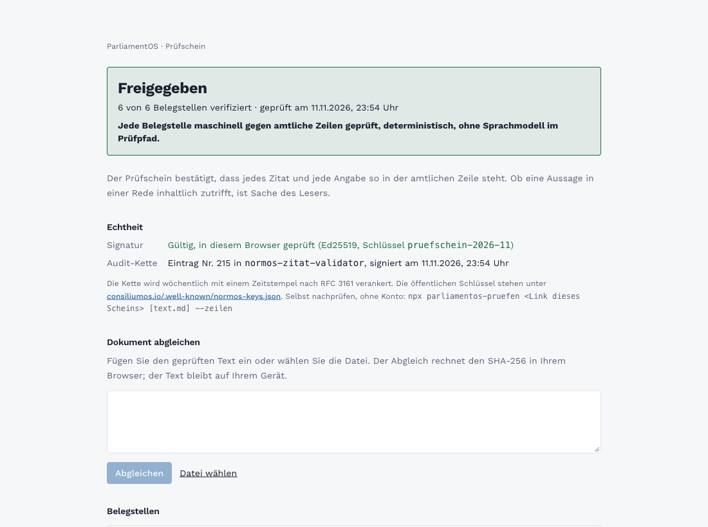

# ParliamentOS für Claude

**Belegte Antworten zu Bundestag, Landtagen, Nationalrat und EU-Parlament: jede Aussage mit Kennung, amtlicher Zeile
und Original, die fertige Antwort mit signiertem Prüfschein.**

[](https://github.com/Consilium-Intelligence/parliamentos-skills/actions/workflows/waechter.yml)


[English below](#english)

## In einer Minute startklar (Claude Code)

```
/plugin marketplace add Consilium-Intelligence/parliamentos-skills
/plugin install parliamentos@parliamentos-skills
/mcp
```

Mit `/mcp` meldest du dich bei ParliamentOS an. Das kostenlose Konto legst du dort in zwei Minuten an: 100 Aufrufe
und 20 Prüfscheine im Monat, mit den Werkzeugen `search`, `fetch`, `get_beleg` und `pruefe_belege`.

**Andere Clients** (claude.ai, ChatGPT, weitere MCP-Clients): Connector mit der Adresse
`https://slbysjtdcfwilupwqerr.supabase.co/functions/v1/parliamentos-mcp` hinzufügen. Dieselben Regeln wie im Skill
kommen dort als Prompt `belegte_antwort` mit.

## So sieht eine belegte Antwort aus

Frage: *Wer hat die Verlängerung der Mietpreisbremse eingebracht, und was ist daraus geworden?*

> CDU/CSU und SPD legten den Gesetzentwurf zur Verlängerung der Mietpreisbremse als Drucksache 21/322 am 03.06.2025
> vor [[beleg:ds:279704]]. Der Bundestag nahm ihn am 26.06.2025 in Ausschussfassung an [[beleg:bt-vorgang:322261]].
>
> Bundesjustizministerin Hubig brachte den Entwurf in erster Lesung ein: „Ich möchte mich ganz herzlich bei den
> Regierungsfraktionen bedanken, dass das so schnell gegangen ist“ (Hubig, 05.06.2025)
> [[beleg:bt-rede:dip_bt_21_10_ID211000200]]
>
> Belege:
> [[beleg:ds:279704]] Beleg: https://consiliumos.io/beleg/ds/279704, Original: https://dserver.bundestag.de/btd/21/003/2100322.pdf
> [[beleg:bt-vorgang:322261]] Beleg: https://consiliumos.io/beleg/bt-vorgang/322261, Original: https://dip.bundestag.de/vorgang/-/322261
> [[beleg:bt-rede:dip_bt_21_10_ID211000200]] Beleg: https://consiliumos.io/beleg/bt-rede/dip_bt_21_10_ID211000200, Original: https://dserver.bundestag.de/btp/21/21010.pdf
>
> 6 Belegstellen zu 3 Kennungen aus ParliamentOS, jede Belegstelle maschinell gegen amtliche Zeilen geprüft,
> deterministisch, ohne Sprachmodell im Prüfpfad. Prüfschein: https://consiliumos.io/pruefschein/f3a8112c-8498-4075-a64a-8f613298bd7b

Der Prüfschein zu genau dieser Antwort, öffentlich lesbar und ohne Konto:

[](https://consiliumos.io/pruefschein/f3a8112c-8498-4075-a64a-8f613298bd7b)

Selbst nachrechnen, ohne Konto: `npx parliamentos-pruefen https://consiliumos.io/pruefschein/f3a8112c-8498-4075-a64a-8f613298bd7b`

## Was der Prüfschein abdeckt

- **Abgedeckt:** jede Belegstelle. Der Zitat-Validator löst jede Kennung zu genau einer amtlichen Zeile auf und
  vergleicht Wortlaut, Datum, Person, Partei, Votum, Stimmenzahlen und Beträge mit dieser Zeile.
- **Echtheit:** Der Schein ist mit Ed25519 signiert und in einer Hash-Kette verankert; die öffentlichen Schlüssel
  stehen unter https://consiliumos.io/.well-known/normos-keys.json.
- **Beim Leser:** ob die Antwort vollständig ist und wie sie eine Rede oder einen Beschluss bewertet. Aussagen ohne
  Kennung gelten als ungeprüft.

Was eine Kennung ist und welche Belegarten geprüft werden: https://consiliumos.io/beleg-vertrag

## Was im Plugin steckt

| Datei | Inhalt |
|---|---|
| `plugins/parliamentos/skills/belegen/SKILL.md` | Die Regeln: erst suchen, dann schreiben, Zitierformat, Prüfschritt |
| `plugins/parliamentos/.mcp.json` | Connector zu ParliamentOS, Anmeldung per OAuth |
| `plugins/parliamentos/.claude-plugin/plugin.json` | Manifest für Claude Code |

Bestand und Zeiträume je Parlament: https://consiliumos.io/quellen

## Datenschutz

- Der Skill ist Text und verarbeitet selbst keine Daten.
- ParliamentOS protokolliert jeden Werkzeugaufruf mit seinen Parametern, also auch Suchbegriffe
  (Datenschutzerklärung, Abschnitt 5b: https://consiliumos.io/privacy). Der Skill hält Suchbegriffe darum knapp.
- Ein Prüfschein speichert den Hash der Antwort, die Kennungen und die Urteile. Der Antworttext bleibt beim Nutzer.
- Konten, Protokoll und Prüfscheine liegen in der Datenbank in Frankfurt am Main (Supabase, eu-central-1).

## Mitmachen und Sicherheit

- Fehler, Fragen und Datenbefunde: Issues mit Vorlage, siehe [CONTRIBUTING.md](CONTRIBUTING.md).
- Sicherheitslücken vertraulich: [SECURITY.md](SECURITY.md).
- Änderungen: [CHANGELOG.md](CHANGELOG.md). Lizenz: [MIT](LICENSE).

Ein Produkt von ConsiliumOS · https://consiliumos.io · Rückmeldungen an albrecht@consiliumos.io

---

<a id="english"></a>

## English

**Cited answers about the German Bundestag, German state parliaments, the Austrian Nationalrat and the European
Parliament: every statement carries a citation ID, the official record and the original document; the finished
answer gets a signed verification certificate.**

### Get started (Claude Code)

```
/plugin marketplace add Consilium-Intelligence/parliamentos-skills
/plugin install parliamentos@parliamentos-skills
/mcp
```

`/mcp` signs you in to ParliamentOS. The free account takes two minutes: 100 calls and 20 certificates per month,
with the tools `search`, `fetch`, `get_beleg` and `pruefe_belege`. Other MCP clients (claude.ai, ChatGPT and more)
connect to `https://slbysjtdcfwilupwqerr.supabase.co/functions/v1/parliamentos-mcp`; the same rules ship as the
prompt `belegte_antwort`.

### What you get

The skill `belegen` ("to cite") teaches the model to search first, write second, attach the citation ID of the
matching official record to each statement, and submit the finished answer to `pruefe_belege`. The certificate
above was issued for exactly the example answer shown in the German section.

### What the certificate covers

- **Covered:** every citation. The validator resolves each ID to exactly one official record and compares quotes,
  dates, speakers, parties, votes, vote counts and amounts with that record.
- **Authenticity:** Ed25519 signature, anchored in a hash chain; public keys at
  https://consiliumos.io/.well-known/normos-keys.json. Verify yourself: `npx parliamentos-pruefen <certificate link>`.
- **Left to the reader:** completeness of the answer and its assessment of a speech or decision. Statements
  without a citation ID count as unverified.

### Privacy

ParliamentOS logs every tool call with its parameters, including search terms (privacy policy, section 5b:
https://consiliumos.io/privacy). A certificate stores the answer's hash, the citation IDs and the verdicts; the
answer text stays with the user. Accounts, logs and certificates are stored in Frankfurt am Main, Germany
(Supabase, eu-central-1).

### Contributing and security

Issues and pull requests: see [CONTRIBUTING.md](CONTRIBUTING.md). Vulnerabilities: please report privately, see
[SECURITY.md](SECURITY.md). License: MIT.
